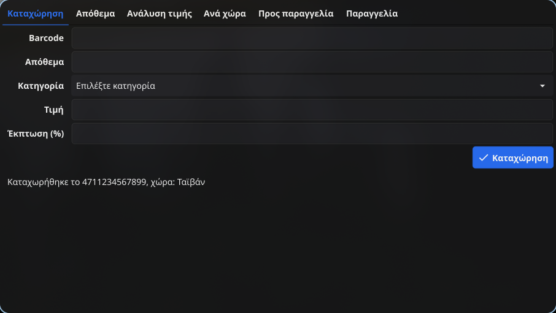
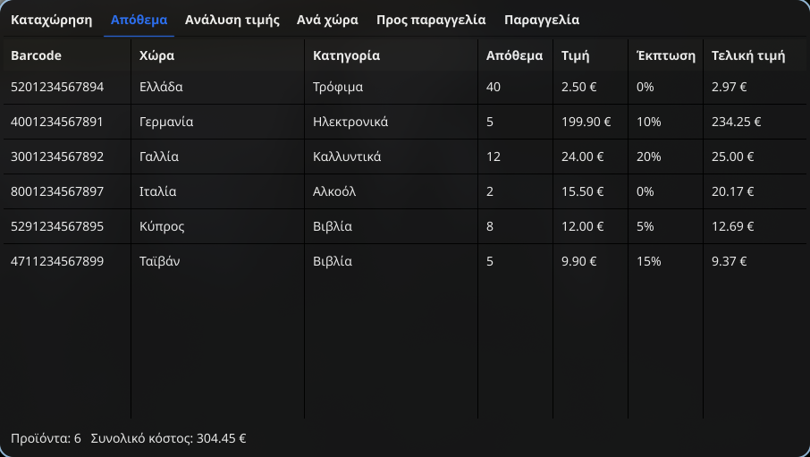
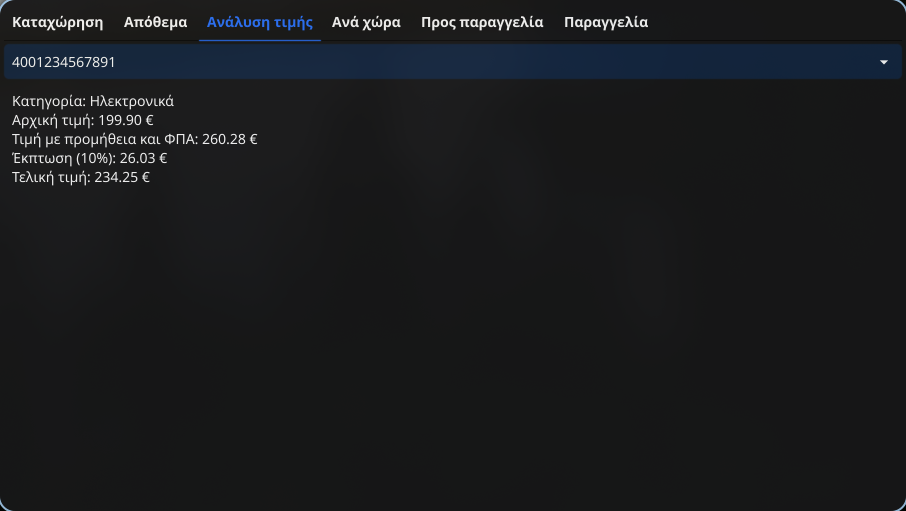
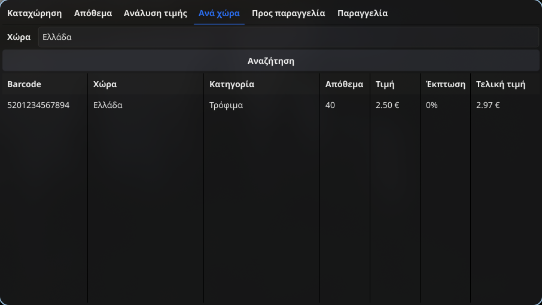
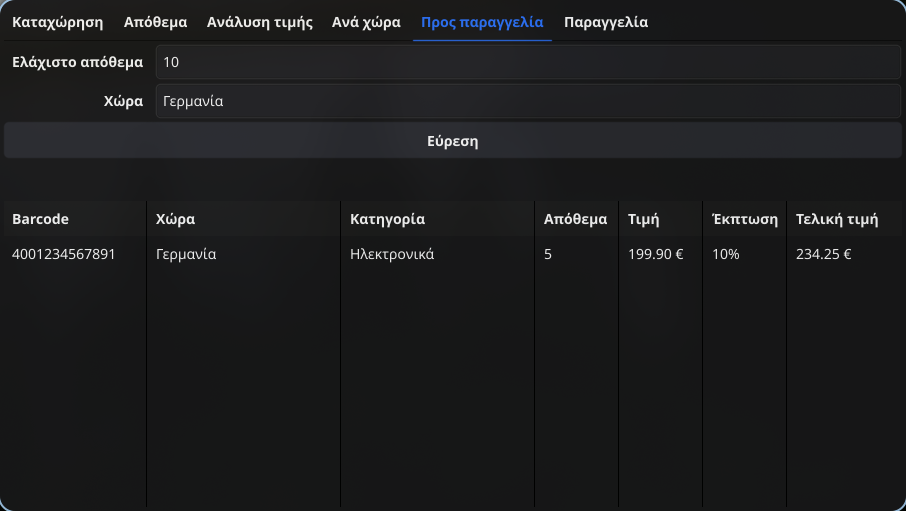
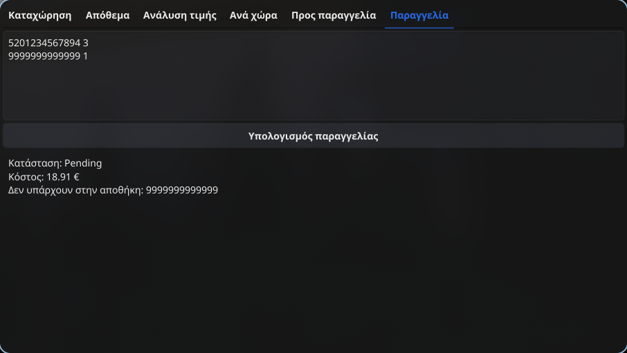

# warehouse-manager

Εργασία στο μάθημα Ποιότητα και Αξιοπιστία Λογισμικού ΧΕΙΜ-2026

## Εισαγωγή

Το project είναι ένα απλό σύστημα διαχείρισης αποθήκης σε Go. Αποτελείται από
τρία μέρη:

- `warehouse/`: η βιβλιοθήκη με τις 7 συναρτήσεις της εκφώνησης και τους
  ελέγχους μονάδας τους (`*_test.go`)
- `cmd/client/`: η εφαρμογή πελάτη, ένα παράθυρο με καρτέλες φτιαγμένο με
  [Fyne](https://fyne.io)
- `document/`: η τεχνική έκθεση σε Typst

Το τελικό παραδοτέο (έκθεση σε PDF και κώδικας) υπάρχει στο
[release v1.0](../../releases/tag/v1.0).

### Εκτέλεση

Χρειάζεται Go και, για το Fyne, ένας C compiler (π.χ. `gcc`). Το πρώτο build
αργεί ένα με δύο λεπτά, γιατί το Fyne κάνει compile κώδικα C για τα γραφικά.

```sh
go run ./cmd/client                 # η εφαρμογή
go test -v ./warehouse              # οι έλεγχοι
go test -cover ./warehouse          # κάλυψη κώδικα (100%)
typst compile document/main.typ     # η έκθεση σε PDF
```

### Χρήση της εφαρμογής

Η εφαρμογή ξεκινά με 5 έτοιμα προϊόντα, ώστε να υπάρχουν δεδομένα σε όλες τις
καρτέλες. Τα προϊόντα κρατιούνται μόνο στη μνήμη και χάνονται όταν κλείσει η
εφαρμογή.

#### Καταχώρηση

Συμπληρώνουμε barcode, απόθεμα, κατηγορία, τιμή και έκπτωση και πατάμε
«Καταχώρηση». Το barcode ελέγχεται με το `CheckBarcode` και η χώρα βγαίνει
αυτόματα από το `FindCountry`. Αν το barcode δεν είναι έγκυρο, εμφανίζεται το
μήνυμα λάθους.

Παράδειγμα: `4711234567899`, απόθεμα 5, Βιβλία, τιμή 9.90, έκπτωση 15.



#### Απόθεμα

Δείχνει όλα τα προϊόντα με την τελική τιμή τους, και στο κάτω μέρος το
συνολικό κόστος της αποθήκης (`CalculateTotalCost`).



#### Ανάλυση τιμής

Επιλέγουμε ένα barcode και βλέπουμε την αρχική τιμή, την τιμή με προμήθεια
και ΦΠΑ, το ποσό της έκπτωσης και την τελική τιμή (`CalculateCost`).



#### Ανά χώρα

Γράφουμε μια χώρα, π.χ. «Ελλάδα», και πατάμε «Αναζήτηση»
(`CountryProducts`). Η αναζήτηση δεν κοιτάει κεφαλαία και ακραία κενά, αλλά
κοιτάει τους τόνους: «ελλάδα» βρίσκει αποτελέσματα, «ελλαδα» όχι.



#### Προς παραγγελία

Δίνουμε ελάχιστο απόθεμα και χώρα, π.χ. 10 και «Γερμανία», και πατάμε
«Εύρεση». Εμφανίζονται τα προϊόντα της χώρας με απόθεμα κάτω από το όριο
(`ProductsToOrder`).



#### Παραγγελία

Γράφουμε μία γραμμή ανά προϊόν με barcode και ποσότητα, και πατάμε
«Υπολογισμός παραγγελίας» (`CalculateOrder`). Εμφανίζεται η κατάσταση
(`Executable` ή `Pending`) και το κόστος, με 10 € μεταφορικά αν τα προϊόντα
κοστίζουν κάτω από 50 €. Αν κάποιο barcode δεν υπάρχει στην αποθήκη, η
εφαρμογή το αναφέρει.

Παράδειγμα:

```
5201234567894 3
9999999999999 1
```



## Ομάδα

- Μάριος Παπάζογλου 21390179
- Χρήστος Κρικζώνης 21390108

άρα Team_PK_SoftwareQuality.zip

## Κατανομή

| Μέρος                    | Υπεύθυνος                             | Τι περιλαμβάνει                                                              |
| ------------------------ | ------------------------------------- | ---------------------------------------------------------------------------- |
| A ([#1](../../issues/1)) | Μάριος (με συμμετοχή και του Χρήστου) | `CheckBarcode`, `FindCountry`, `CalculateCost`, εφαρμογή                     |
| B ([#2](../../issues/2)) | Χρήστος                               | `CalculateTotalCost`, `CountryProducts`, `ProductsToOrder`, `CalculateOrder` |
| Τεκμηρίωση (`document/`) | Και οι δύο, παράλληλα                 | Τεχνική έκθεση σε Typst                                                      |

## Development Setup

Μία φορά μετά το clone τρέξε το pre-commit hook (gofmt, go vet, go test):

```sh
git config core.hooksPath .githooks
```
